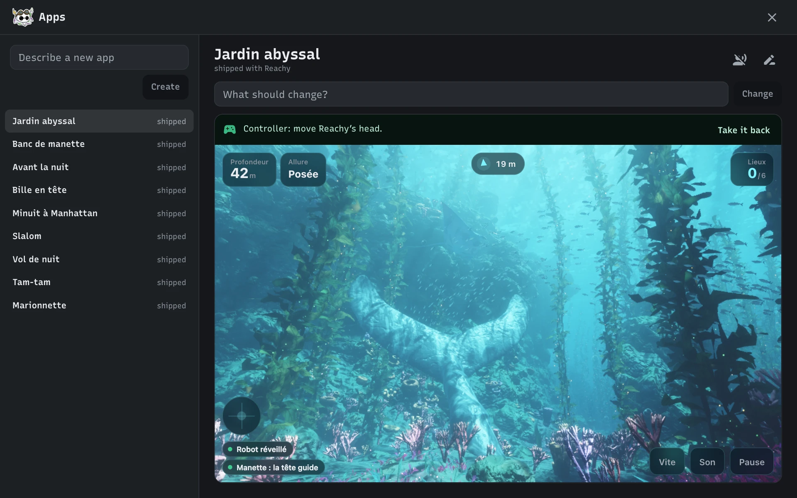
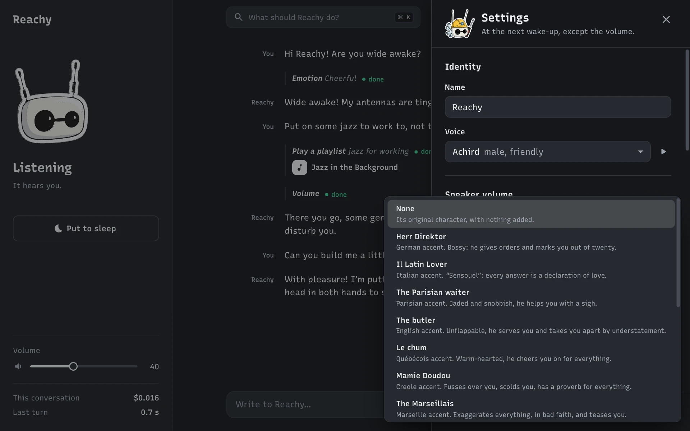
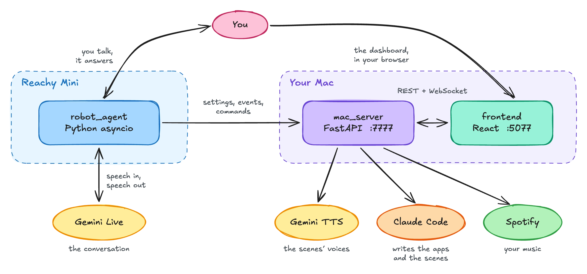

# Reachy Mini Companion

**A [Reachy Mini](https://www.pollen-robotics.com/reachy-mini/) you talk to.** Wiggle an antenna: it wakes up, listens,
answers out loud and moves while it speaks. Behind it, a dashboard on your Mac shapes its character, stages little
plays, and builds games you play with the robot itself in your hands.


[](https://github.com/RuellePaul/reachy-mini-companion/actions/workflows/ci.yml)
[](LICENSE)

> **Languages.** The dashboard is in English or French: pick yours in the settings. The robot itself converses in
> French, and the apps and scenes it ships with are written in French. The code, its comments and these docs are in
> English.

## What it does

- **A real conversation.** Speech in, speech out, on Gemini Live: no transcription step, no push-to-talk. The server
  decides whose turn it is, and you can type to the robot too. It goes back to sleep on its own, and the dashboard
  shows what each conversation costs.
- **A body that takes part.** Animations for waiting, listening and talking; 11 gestures and 25 of Pollen's recorded
  emotions it plays when you ask for them; a head that wobbles with its voice; a gaze that can follow your face.
- **Things it can do for you.** Look through its camera, search the web, play and control your music on Spotify,
  set its volume, go to sleep.
- **Fifteen ready-made characters**, each with an accent and a temper, from a phlegmatic English butler to a
  storyteller from Marseille who exaggerates everything. Or write your own, and pick one of 30 voices.
- **A studio.** Every move on a 3D model before the real robot plays it, with its amplitude and speed to tune.
- **Scenes.** Small plays with several voices, moves and sounds, written like a script. Ask for one in a sentence,
  out loud or in the dashboard, and Claude writes it; the robot performs it.
- **Apps.** Ask for a game, out loud or in the dashboard, and Claude Code writes it as a single sandboxed page.
- **A dashboard in two languages.** English or French, switched at once in the settings and remembered by your
  browser.
- **The robot as a game controller.** An app can hold the robot's body: its head, base and antennas, moved by your
  hands, become the gamepad. Nine apps ship with it, among them an underwater world you swim through with the head
  in your hands, a marble run and a ski slalom steered with the base.

## A quick tour

| | |
|---|---|
|  **Studio** — rehearse any animation, gesture or emotion in 3D, then try it on the robot. |  **Scenes** — a script editor with one voice per character; the robot plays both parts, turning to whoever speaks. |
|  **Apps** — here, an underwater world adapted from Abyssal Garden: hold the robot's head in both hands and you swim through it. |  **Characters** — a name, a voice, a personality; fifteen are ready to pick. |

A palette (<kbd>⌘</kbd><kbd>K</kbd>) reaches everything the robot can do:


## How it works

Three processes ship together:

<!-- The drawing's source is docs/diagrams/how-it-works.excalidraw (open it at excalidraw.com), exported at 2x, once per theme. -->
<picture>
  <source media="(prefers-color-scheme: dark)" srcset="docs/diagrams/how-it-works-dark.webp">
  
</picture>

- **`robot_agent/`** runs on the robot. It holds the conversation (one Gemini Live session per wake), the microphone
  and the speaker, and the robot's only motion engine.
- **`mac_server/`** runs on your Mac. It keeps the settings, queues what the dashboard asks of the robot, renders the
  scenes' voices, and has Claude Code write the apps and the scenes.
- **`frontend/`** is the dashboard. It talks only to the Mac server.

More in [`docs/ARCHITECTURE.md`](docs/ARCHITECTURE.md); every route, event and message is in
[`docs/CONTRACTS.md`](docs/CONTRACTS.md).

## What you need

| | |
|---|---|
| **A Reachy Mini** | The wireless version, with its onboard computer: the agent runs on the robot itself, over SSH. Its daemon must be running (it is by default). Developed against `reachy_mini` 1.10. |
| **A Mac** on the same network | macOS, Python 3.11 or later, [uv](https://docs.astral.sh/uv/), Node 24 with npm 11.19.1 or later, `rsync` and `ssh`. |
| **A Gemini API key** | From [Google AI Studio](https://aistudio.google.com/apikey). Gemini Live and the scenes' voices are billed to it. |
| *Optional:* [Claude Code](https://claude.com/claude-code) | Installed and signed in on the Mac. It writes the apps and the scenes, on your Claude subscription. |
| *Optional:* Google Chrome | Each app Claude writes is run once in a fenced headless Chrome before you see it. Without Chrome, pages are only scanned. |
| *Optional:* Spotify Premium | And an app of your own in the [Spotify developer dashboard](https://developer.spotify.com/dashboard). See [Spotify](#spotify-optional). |

The Mac server has only been run on macOS. CI runs the test suites on Linux.

## Setup from scratch

**1. Get the code and its dependencies**

```bash
git clone https://github.com/RuellePaul/reachy-mini-companion.git
cd reachy-mini-companion

uv sync --locked --extra dev      # the Mac server, in .venv
(cd frontend && npm ci)           # the dashboard
```

The dashboard refuses an npm older than 11.19.1: `npm install -g npm@latest` brings it up to date.

**2. Write your `.env`**

```bash
cp .env.example .env
```

Three lines are required; [`.env.example`](.env.example) explains every other one.

| Variable | What to put |
|---|---|
| `GEMINI_API_KEY` | Your Google AI Studio key. |
| `MAC_AGENT_API_KEY` | A long random secret of your own: `python3 -c 'import secrets; print(secrets.token_urlsafe(32))'`. |
| `MAC_AGENT_URL` | Where the robot reaches your Mac: `http://<your Mac's LAN IP>:7777`. An IP, not a `.local` name. |

`.env` is git-ignored, and it is copied to the robot at each deploy: the robot and the Mac read the same file.

**3. Prepare the robot, once**

```bash
ssh-copy-id pollen@reachy-mini.local   # make up and make run never stop to ask for a password
make robot-deps                        # google-genai and Pillow, in the robot's own Python
make doctor                            # says what is still missing, on the Mac and on the robot
```

If your robot answers at another address, pass it to any target: `make up ROBOT=pollen@192.168.1.50`.

**4. Run**

```bash
make up
```

One shell starts the Mac server, the dashboard and the robot agent (waited for, synced over SSH, then run). One
Ctrl-C stops everything, and the robot takes its sleep pose.

Open <http://localhost:5077>. The dashboard starts in your browser's language; **Settings → Dashboard → Language**
changes it. Wiggle one of the robot's antennas, or click **Wake up**, and talk to it, in French. Wish it good night, or
click **Put to sleep**, and it goes back to sleep.

**Worth doing once per Wi-Fi network:** `make robot-wifi` ties the robot's Wi-Fi to the access point it is on and
turns its power saving off. Without it, background scans cut the robot off from the Mac for seconds at a time.
`make robot-wifi WIFI=unlock` undoes it.

### Try it without a robot

A stand-in robot lets you explore the dashboard, the studio, the scenes and the apps with no hardware. It needs a
server of its own, on its own port and with its own state, so it never touches your real setup. In three terminals:

```bash
# a test Mac server
MAC_AGENT_PORT=7797 REACHY_STATE_DIR=/tmp/reachy-bench SETTINGS_PATH=/tmp/reachy-bench/settings.json \
    REACHY_CACHE_DIR=/tmp/reachy-bench/cache REACHY_HOST=127.0.0.1 REACHY_PORT=8797 .venv/bin/python -m mac_server

# its dashboard, on http://localhost:5087
(cd frontend && VITE_MAC_AGENT_URL=http://localhost:7797 npx vite --port 5087 --strictPort)

# the stand-in robot
.venv/bin/python scripts/fake_robot.py --port 7797 --daemon 8797
```

The screenshots above were taken this way. The `.env` file is still needed: all three read `MAC_AGENT_API_KEY` from it.

### Spotify (optional)

Create an app in the Spotify developer dashboard with the redirect URI
`http://127.0.0.1:7777/api/spotify/callback`, put its `SPOTIFY_CLIENT_ID` and `SPOTIFY_CLIENT_SECRET` in `.env`, then,
with the Mac server running:

```bash
make spotify-auth
```

## Commands

| Command | What it does |
|---|---|
| `make up` | Everything in one shell: the Mac server, the dashboard and the robot agent. |
| `make dev` | The Mac server and the dashboard, without the robot. |
| `make run` | Sync and run the robot agent in the foreground, over SSH. |
| `make robot-deps` | Install the robot's Python dependencies. |
| `make robot-wifi` | Tie the robot's Wi-Fi to its access point (`WIFI=unlock`, `WIFI=status`). |
| `make spotify-auth` | Authorise Spotify, once. |
| `make doctor` | Check the tools, the `.env` keys and the robot's dependencies. |
| `make logs` | Tail the Mac server and the robot agent together. |
| `make lint` · `make format` · `make test` | The quality gate: ruff, prettier, eslint, knip, pytest, vitest. |

## What it costs

- **Gemini Live** bills every turn, with the whole context each time. The project keeps that context small
  (compression, a short system prompt, a sleep after a few idle minutes) and shows the running cost of each
  conversation in the dashboard. Asleep, the robot holds no session and costs nothing.
- **Scene voices** are rendered once with Gemini TTS, then cached on the Mac.
- **Apps and scenes** are written through the `claude` CLI on your Claude subscription. The project never reads an
  `ANTHROPIC_API_KEY`.

## Safety and security

This is made for a home network you trust, and for nothing wider. Do not expose either port to the internet.

- **Set `MAC_AGENT_API_KEY`.** Every route of the Mac server (port 7777) requires it. Left empty, the server answers
  anyone on your network, and any web page open on the Mac.
- **The dashboard's port is as open as your network.** Its dev server (port 5077) listens on the local network, so
  that a phone can open the dashboard, and adds the key to what it relays. It refuses other websites' pages; it
  cannot tell a device on your network from your phone. Whoever reaches that port can do what the dashboard does:
  do not run it on a shared network.
- **The robot and the Mac talk over plain HTTP**, the key in each request: someone able to listen on your network
  can read it.
- **`.env` is copied whole to the robot** at each deploy. If the robot still has the SSH password it shipped with,
  change it.
- **The motors are freed on a human gesture**: a click or a key in the app that asks, there and then. The dashboard
  enforces that rule; the Mac server and the robot obey whoever holds the key.
- **Apps are model-written code**, and treated as such: scanned, run once in a fenced Chrome, then shown in a
  sandboxed iframe with no key, no storage and a policy that blocks network requests. The scan catches accidents,
  not intent: treat a page someone hands you like any program. See
  [`docs/ARCHITECTURE.md`](docs/ARCHITECTURE.md#apps-are-untrusted-code).
- **Text from outside can steer it.** A web search result or a track's title reaches the model like any other
  text, and may trigger its tools during your turn.

## Development

```bash
npm ci          # once, at the repo root: installs the pre-commit hook
make lint       # ruff, prettier, eslint, knip, and a size budget
make test       # pytest (offline) and vitest
cd frontend && npx tsc -b
```

CI runs the same gates on every pull request. The tests need neither a robot nor an API key.

- [`CLAUDE.md`](CLAUDE.md) is the working guide to the codebase: what runs where, the invariants that keep the robot
  well-behaved, and the working rules. It is written for coding agents and reads just as well for humans.
- A payload changes in `mac_server/contracts.py` first, then in the dashboard's Zod schemas and the examples.
- `scripts/app_bench.py` runs an app's page on a bench, with no robot and no dashboard.
- Every text the dashboard shows is written in both languages, in its subject's `words.ts`; a test fails on one
  written anywhere else. What the Mac server labels is translated in `frontend/src/mac.en.json`.
- French text keeps its typography (a no-break space before `: ; ! ?`); tests enforce it.

Issues and pull requests are welcome. Say in a pull request what you could only check on a real robot, and whether
you did.

## Credits

- [Pollen Robotics](https://www.pollen-robotics.com/) makes Reachy Mini, its SDK and its library of recorded
  emotions. The 3D model in the studio is derived from their URDF (Apache-2.0, see
  [`frontend/public/robot.glb.LICENSE.md`](frontend/public/robot.glb.LICENSE.md)), and the head wobble is ported from
  their conversation app.
- The stickers in the dashboard are drawings of Reachy Mini by Pollen Robotics and Seeed Studio
  ([`frontend/public/stickers/SOURCES.md`](frontend/public/stickers/SOURCES.md)). They remain the property of their
  authors and are not covered by this project's license.
- The underwater app adapts [Abyssal Garden](https://github.com/Noniv/abyssal-garden) by Maksymilian Dendura (MIT);
  its notice is kept in the page.
- Face detection uses [YuNet](https://github.com/opencv/opencv_zoo/tree/main/models/face_detection_yunet) from the
  OpenCV Zoo (MIT).
- The voice samples were generated with Gemini's speech models.

This is an independent project. It is not affiliated with or endorsed by Pollen Robotics, Hugging Face, Seeed Studio,
Google, Anthropic or Spotify.

## License

[MIT](LICENSE)
