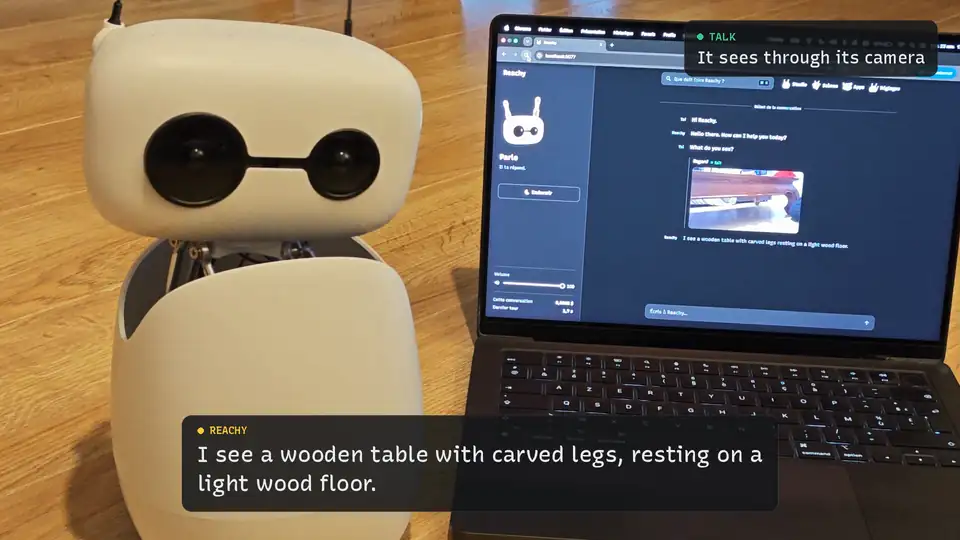
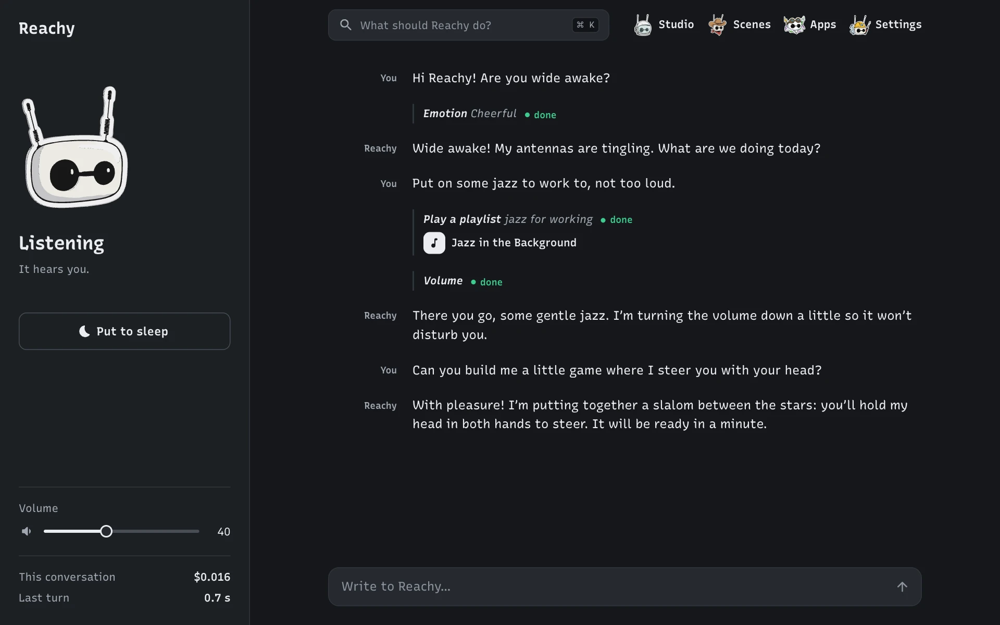
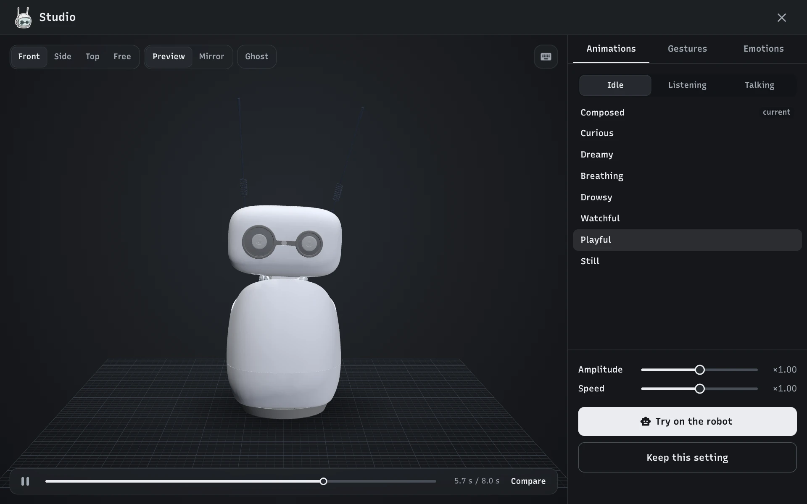
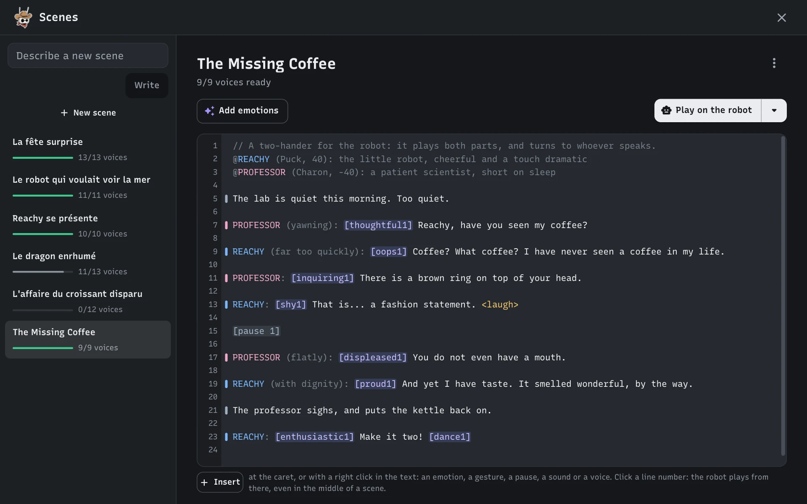
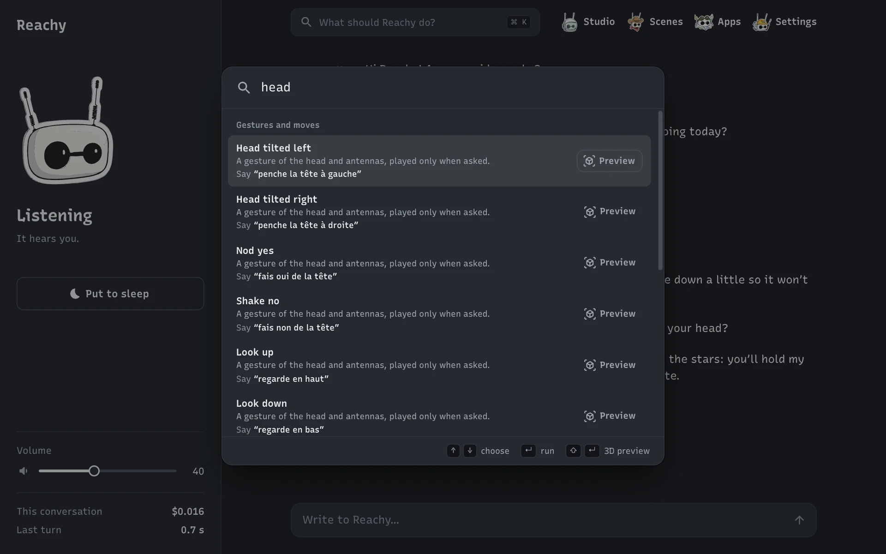

<h1 align="center">Reachy Mini Companion</h1>

<p align="center">
  <b>Talk to your <a href="https://www.pollen-robotics.com/reachy-mini/">Reachy Mini</a>. Ask it for an app. Ask it for a scene.</b>
</p>

<p align="center">
  <a href="https://github.com/RuellePaul/reachy-mini-companion/actions/workflows/ci.yml"></a>
  <a href="LICENSE"></a>
</p>

<p align="center">
  <a href="#what-it-does">What it does</a> ·
  <a href="#quick-start">Quick start</a> ·
  <a href="#try-it-without-a-robot">No robot?</a> ·
  <a href="#how-it-works">How it works</a> ·
  <a href="#safety-and-security">Safety</a>
</p>

<!-- A few seconds of the demo, silent: cut from the film itself. -->
<p align="center">
  
</p>

Wiggle an antenna: the robot wakes up, listens, answers out loud and moves while it speaks. On your Mac, a dashboard
shapes its character, stages little plays, and builds games you play with the robot itself in your hands.

## What it does

| | |
|---|---|
| **Conversation** | Speech in, speech out, on Gemini Live. No wake word, no push-to-talk: wiggle an antenna and talk. You can type to it too, and it goes back to sleep on its own. |
| **Body** | It moves while it waits, listens and speaks, its head wobbling with its voice. It knows 11 gestures and 25 of Pollen's recorded emotions, and its gaze can follow your face. |
| **Skills** | It looks through its camera, searches the web, and plays and controls your music on Spotify. |
| **Character** | A name, one of 30 voices, and a personality: fifteen are ready-made, each with its accent and its temper, or write your own. |
| **Scenes** | Small plays for several voices, with moves and sounds. Ask for one in a sentence: Claude writes and stages it, each character gets a voice, and the robot performs it. |
| **Apps** | Ask for a game and Claude Code builds it as one sandboxed page. An app can borrow the robot's body: its head, base and antennas, in your hands, become the controller. Nine ship with it. |
| **Dashboard** | The conversation as it happens and what it costs, a 3D studio for every move, a palette (<kbd>⌘</kbd><kbd>K</kbd>) that reaches everything the robot can do. In English or French. |

> **Languages.** The dashboard is in English or French: pick yours in its settings. The robot itself speaks French:
> its prompt, and the apps and scenes it ships with, are written in French. The demo and the screenshots on this
> page were made with an English translation of them.

### A quick tour



| | |
|---|---|
|  **Studio.** Watch any animation, gesture or emotion on a 3D model, tune an animation's amplitude and speed, then try it on the robot. |  **Scenes.** A script editor with one voice per character. The robot plays every part, or rehearses with you: you say one character's lines. |
|  **Apps.** Here, an underwater world adapted from Abyssal Garden: hold the robot's head in both hands and you swim through it. |  **Characters.** From a phlegmatic English butler to a Marseillais who exaggerates everything: fifteen to pick from, or to rewrite. |



## Quick start

**You need:**

| | |
|---|---|
| **A Reachy Mini**, the wireless version | The agent runs on the robot's own computer, deployed over SSH. Developed against `reachy_mini` 1.10. |
| **A Mac** on the same network | Python 3.11 or later, [uv](https://docs.astral.sh/uv/), Node 24 (npm 11.19.1 or later), `rsync` and `ssh`. |
| **A Gemini API key** | From [Google AI Studio](https://aistudio.google.com/apikey). The conversation and the scenes' voices are billed to it. |
| *Optional:* [Claude Code](https://claude.com/claude-code) | Signed in, with `claude` on your `PATH`. It writes the apps and the scenes, on your Claude subscription. |
| *Optional:* Google Chrome | Each app Claude writes is run once in a fenced headless Chrome before you see it. Without Chrome, it is only scanned. |
| *Optional:* Spotify Premium | And an app of your own in the Spotify developer dashboard: see [Spotify](#spotify-optional). |

**1. Install**

```bash
git clone https://github.com/RuellePaul/reachy-mini-companion.git
cd reachy-mini-companion

uv sync --locked --extra dev      # the Mac server, in .venv
(cd frontend && npm ci)           # the dashboard
cp .env.example .env              # your keys: see below
```

`npm ci` refuses an npm older than 11.19.1: `npm install -g npm@latest` brings it up to date.

**2. Fill in `.env`**

| Variable | What to put |
|---|---|
| `GEMINI_API_KEY` | Your Google AI Studio key. The robot does not start without it. |
| `MAC_AGENT_API_KEY` | A long random secret of your own: `python3 -c 'import secrets; print(secrets.token_urlsafe(32))'`. Left empty, the Mac server answers anyone on your network. |
| `MAC_AGENT_URL` | Where the robot finds your Mac: `http://<your Mac's LAN IP>:7777`. An IP, not a `.local` name. |

The file is git-ignored, and copied to the robot at each deploy: the robot and the Mac read the same one.
[`.env.example`](.env.example) explains every other line.

**3. Prepare the robot, once**

```bash
ssh-copy-id pollen@reachy-mini.local   # so that a deploy never stops to ask for a password
make robot-deps                        # google-genai and Pillow, in the robot's own Python
make doctor                            # says what is still missing, on the Mac and on the robot
```

**4. Run**

```bash
make up
```

One shell runs the Mac server, the dashboard and the robot agent; one <kbd>Ctrl</kbd><kbd>C</kbd> stops them all, and
the robot takes its sleep pose.

Open <http://localhost:5077>, wiggle one of the robot's antennas or click **Wake up**, and talk to it, in French. Wish
it good night, or click **Put to sleep**, and it goes back to sleep.

Good to know:

- **The robot answers at another address?** Pass it to any target: `make up ROBOT=pollen@192.168.1.50`.
- **Once per Wi-Fi network**, run `make robot-wifi`: it ties the robot's Wi-Fi to the access point it is on and turns
  its power saving off. Without it, background scans cut the robot off from the Mac for seconds at a time.
  `make robot-wifi WIFI=unlock` undoes it.
- **Settings apply at the next wake-up**, the volume aside: it applies at once.

<details>
<summary><b>Every command</b></summary>

| Command | What it does |
|---|---|
| `make up` | Everything in one shell: the Mac server, the dashboard and the robot agent. |
| `make dev` | The Mac server and the dashboard, without the robot. |
| `make run` | Sync and run the robot agent in the foreground, over SSH. |
| `make robot-deps` | Install the robot's Python dependencies. |
| `make robot-wifi` | Tie the robot's Wi-Fi to its access point (`WIFI=unlock`, `WIFI=status`). |
| `make spotify-auth` | Authorise Spotify, once. |
| `make doctor` | Check the tools, the `.env` keys and the robot's dependencies. |
| `make logs` | Tail the Mac server and the robot agent together. |
| `make lint` · `make test` | Ruff, prettier, eslint, knip and a size budget; pytest and vitest. |
| `make format` | Apply the formatters' fixes. |

`make help` prints them all.

</details>

### Spotify (optional)

Create an app in the [Spotify developer dashboard](https://developer.spotify.com/dashboard) with the redirect URI
`http://127.0.0.1:7777/api/spotify/callback`, put its `SPOTIFY_CLIENT_ID` and `SPOTIFY_CLIENT_SECRET` in `.env`, then,
with the Mac server running:

```bash
make spotify-auth
```

## Try it without a robot

A stand-in robot lets you try what needs no conversation: the dashboard and its settings, the studio's 3D previews,
the scene editor, the palette, and the apps, played with a simulated controller. It does not talk, and it plays
neither a move nor a scene.

It runs beside a Mac server of its own, on its own port and with its own state, so it never touches a real setup.

<details>
<summary><b>Three terminals</b></summary>

```bash
# a test Mac server
MAC_AGENT_PORT=7797 REACHY_STATE_DIR=/tmp/reachy-bench SETTINGS_PATH=/tmp/reachy-bench/settings.json \
    REACHY_CACHE_DIR=/tmp/reachy-bench/cache REACHY_HOST=127.0.0.1 REACHY_PORT=8797 .venv/bin/python -m mac_server

# its dashboard, on http://localhost:5087
(cd frontend && VITE_MAC_AGENT_URL=http://localhost:7797 npx vite --port 5087 --strictPort)

# the stand-in robot
.venv/bin/python scripts/fake_robot.py --port 7797 --daemon 8797
```

The `.env` file is still needed: all three read `MAC_AGENT_API_KEY` from it. Building an app or writing a scene still
takes Claude Code, and a scene's voices a Gemini key.

</details>

## How it works

<!-- The drawing's source is docs/diagrams/how-it-works.excalidraw (open it at excalidraw.com), exported at 2x, once per theme. -->
<picture>
  <source media="(prefers-color-scheme: dark)" srcset="docs/diagrams/how-it-works-dark.webp">
  
</picture>

Three processes ship together:

- **[`robot_agent/`](robot_agent)** runs on the robot. It holds the conversation (one Gemini Live session per wake),
  the microphone and the speaker, and the robot's only motion engine.
- **[`mac_server/`](mac_server)** runs on your Mac. It keeps the settings, queues what the dashboard asks of the
  robot, renders the scenes' voices, and has Claude Code write the apps and the scenes.
- **[`frontend/`](frontend)** is the dashboard. It talks only to the Mac server.

Two constraints decide every trade-off: the conversation's latency, and what Gemini bills.
[`docs/ARCHITECTURE.md`](docs/ARCHITECTURE.md) tells how; every route, event and message is in
[`docs/CONTRACTS.md`](docs/CONTRACTS.md).

## What it costs

- **Gemini Live** bills every turn, with the whole context each time. The project keeps that context small
  (compression, a short system prompt, a sleep after a few idle minutes), and the dashboard shows what the
  conversation under way has cost. Asleep, the robot holds no session and costs nothing.
- **Scene voices** are rendered once with Gemini TTS, then cached on the Mac.
- **Apps and scenes** are written through the `claude` CLI, on your Claude subscription. The project never reads an
  `ANTHROPIC_API_KEY`.

## Safety and security

This is made for a home network you trust, and for nothing wider. Never expose port 7777 or 5077 to the internet.

- **Set `MAC_AGENT_API_KEY`.** The Mac server asks for it on every route, the Spotify sign-in aside, which answers
  the Mac alone. Left empty, the server answers anyone on your network, and any web page open on the Mac.
- **The dashboard is as open as your network.** Its dev server listens on the local network, so that a phone can
  open it, and adds the key to what it relays. It refuses other websites' pages; it cannot tell a stranger's device
  from your phone. Do not run it on a shared network.
- **The robot and the Mac talk over plain HTTP**, the key in each request: someone listening on your network can
  read it.
- **`.env` is copied whole to the robot** at each deploy. If the robot still has the SSH password it shipped with,
  change it.
- **The motors are freed on a human gesture only**: your click or key in the app that asks, there and then. The
  dashboard enforces that rule; the Mac server and the robot obey whoever holds the key.
- **Apps are model-written code**, and treated as such: scanned, run once in a fenced Chrome, then shown in a
  sandboxed iframe with no key, no storage and no network. The scan catches accidents, not intent: treat a page
  someone hands you like any program. More in
  [`docs/ARCHITECTURE.md`](docs/ARCHITECTURE.md#apps-are-untrusted-code).
- **Text from outside can steer it.** A web search result or a track's title reaches the model like any other text,
  and may trigger its tools during your turn.

## Development

```bash
npm ci                      # once, at the repo root: installs the pre-commit hook
make lint                   # ruff, prettier, eslint, knip and a size budget
make test                   # pytest (offline) and vitest
cd frontend && npx tsc -b   # the dashboard's types
```

CI runs the same checks on every pull request. The tests need neither a robot nor an API key.

- [`CLAUDE.md`](CLAUDE.md) is the working guide to the codebase: what runs where, the invariants that keep the robot
  well-behaved, and the working rules. It is written for coding agents and reads just as well for humans.
- `scripts/app_bench.py` runs an app's page on a bench, with no robot and no dashboard.
- The Mac server has only been run on macOS; CI runs the test suites on Linux.

Issues and pull requests are welcome. Say in a pull request what you could only check on a real robot, and whether
you did.

## Credits

- [Pollen Robotics](https://www.pollen-robotics.com/) makes Reachy Mini, its SDK and its library of recorded
  emotions. The 3D model in the studio is derived from their URDF (Apache-2.0, see
  [`frontend/public/robot.glb.LICENSE.md`](frontend/public/robot.glb.LICENSE.md)), and the head wobble is ported from
  their conversation app.
- The stickers in the dashboard are drawings of Reachy Mini by Pollen Robotics and Seeed Studio
  ([`frontend/public/stickers/SOURCES.md`](frontend/public/stickers/SOURCES.md)). They remain the property of their
  authors and are not covered by this project's license.
- The underwater app adapts [Abyssal Garden](https://github.com/Noniv/abyssal-garden) by Maksymilian Dendura (MIT);
  its notice is kept in the page.
- Face detection uses [YuNet](https://github.com/opencv/opencv_zoo/tree/main/models/face_detection_yunet) from the
  OpenCV Zoo (MIT).
- The voice samples were generated with Gemini's speech models.

This is an independent project. It is not affiliated with or endorsed by Pollen Robotics, Hugging Face, Seeed Studio,
Google, Anthropic or Spotify.

## License

[MIT](LICENSE)
