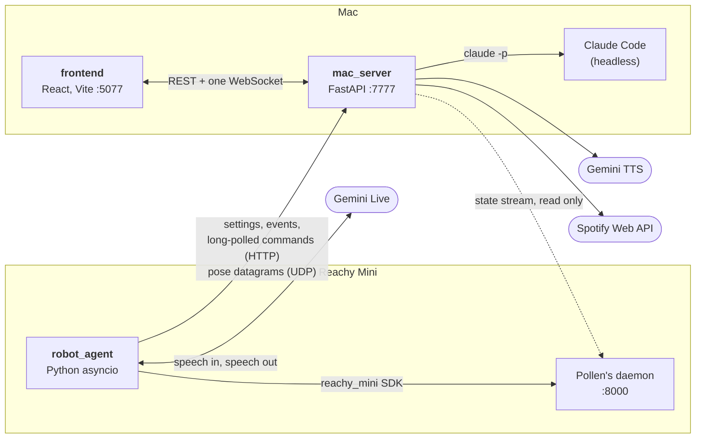

# Architecture

The big picture, for someone about to read the code. The module-by-module guide is [`CLAUDE.md`](../CLAUDE.md);
every payload that crosses a process boundary is in [`CONTRACTS.md`](CONTRACTS.md).

## Three processes

| Process | Where | What it owns |
|---|---|---|
| `robot_agent/` | on the robot, started over SSH | The whole conversation (one Gemini Live session per wake), the microphone and the speaker, and the robot's only motion engine. |
| `mac_server/` | on the Mac, port 7777 | The settings (a JSON file), the command queue the robot long-polls, the robot's health, Spotify, and the three subjects: the studio, the scenes and the apps. The dashboard's API and WebSocket. |
| `frontend/` | on the Mac, port 5077 | The dashboard, in English or French (`src/i18n.ts`, one `words.ts` per subject). It talks only to the Mac server, never to the robot. |

The robot calls the Mac; the Mac never calls the robot. What the dashboard asks of the robot (wake up, play this
move, lend your body to this game) is queued on the Mac as a command with a time to live, and the robot picks it up
on its long poll. The Mac reads the daemon's state stream to draw the robot's pose, and never writes to it.

## Two constraints decide every trade-off

- **Conversational latency.** Nothing blocks the robot's event loop, and nothing on the Mac is awaited on a turn's
  critical path. The microphone is read in a thread, every tool is non-blocking, the settings are fetched once, at
  wake.
- **Cost.** Gemini Live bills the whole context again at every turn, so the context stays small: the system
  instruction and the tool declarations fit in 10 000 characters (a test enforces it), the context is compressed
  from 20 000 tokens down to 8 000, and the robot goes back to sleep when nobody talks to it.

## A conversation, from wake to sleep

1. **Asleep.** The robot holds its sleep pose and opens no session: nothing is billed. It wakes when someone
   wiggles an antenna, or when the dashboard sends `wake`.
2. **Waking.** Three things run in parallel: the wake move, the fetch of the settings from the Mac (name, voice,
   personality, animations), and the connection to Gemini Live.
3. **Talking.** The microphone streams to Gemini, whose answer streams to the speaker. Everything that happens
   becomes an event in `robot_agent/session.py`, and a pure function (`state.py`) decides the next state. The
   dashboard follows along over its WebSocket: the phase, the transcript, the tool calls.
4. **Acting.** The model calls tools: a gesture, an emotion, a body turn, a look through the camera, music, a scene,
   an app. Each one runs as its own task and answers exactly once.
5. **Sleeping.** A spoken goodbye, the dashboard, a long silence, a lost link or Ctrl-C: every ending reaches the
   sleep pose.

### Whose turn it is

Gemini's server-side voice activity detection is the only judge of turns. The robot runs no detector of its own and
no text heuristics. When the server says the human interrupted, the speaker is flushed.

### The robot must not hear itself

A Reachy Mini's motors are as loud as a voice in its own microphone, and the echo canceller knows nothing of them.
While the robot talks or moves, and for a short tail after, Gemini is sent a comfort noise at the room's own level
instead of the microphone. The price is barge-in: `MIC_MUTE_WHILE_TALKING=0` trades it back.

### Tools need a human

A tool runs only if a human spoke or typed in the last 10 seconds. Anything else that reaches the model (a note from
the Mac that a build is ready, a scene's lines) authorises no tool. This is what keeps a robot that hears a
television from acting on it.

## One motion engine

A single 30 Hz thread on the robot steps a pure `Mixer` (`robot_agent/motion.py`): the animation of the current
mode (idle, listening, talking), a move blended over it, the body turn, the wobble of the head while it speaks, the
gaze. Studio tries, scenes and app moves all go through it. The dashboard's 3D preview runs the same code on the
Mac, so what you rehearse is what the robot plays.

## The subjects

Each is a module on the robot, a service with its own router on the Mac, and a full-screen surface in the dashboard.

- **Studio.** Try any animation, gesture or emotion, tune its amplitude and speed, and watch it on a 3D model
  before the robot plays it.
- **Scenes.** Small plays written in a strict play-script grammar (`mac_server/scene_text.py`): characters with
  voices, lines, moves, sounds. The Mac renders each voice once with Gemini TTS and caches it; the robot's
  `Performer` plays the timeline. Claude can write a scene from one sentence, or add emotions to yours.
- **Apps.** Single-page HTML games and toys, written by Claude from a spoken or typed request. See below.
- **Manette.** The robot as a game controller: an app may ask to hold the robot's body, and read the head, the
  base or the antennas a hand moves as a gamepad.

## Apps are untrusted code

An app's page is written by a model, so it is treated as hostile:

- **Built fenced.** Claude Code runs headless with no tool that executes code, confined to a working directory.
- **Scanned.** The result is refused if it uses the network, storage, dialogs, an external URL, or tries to leave.
  The scan reads the page's text for those: it catches what a model writes by accident, not what an author hides.
- **Run once before anyone sees it.** A headless Chrome with no network loads the page and runs its own self-tests;
  a failure goes back to Claude once for repair.
- **Sandboxed in the dashboard.** The page lives in an `<iframe sandbox="allow-scripts" srcdoc>` and nothing more:
  no same-origin, no API key, a Content-Security-Policy prepended to every page served.
- **One narrow door.** The page reaches the robot only through a small versioned bridge (`window.reachy`,
  `mac_server/assets/kit.js`) that the dashboard relays, rate-limited, and that the Mac refuses while the robot
  sleeps.

## Safety rules for the hardware

- A freed motor is never given a target: the motion thread is frozen before a motor is freed, and every motor is
  taken back before anything is written again.
- **No motor is freed without a human asking for it, there and then**: a click or a key in the app that asks, no
  older than 5 seconds. The dashboard enforces it and tells the Mac (`grant`); the Mac and the robot take its
  word, so the rule holds as far as the API key does.
- The body turn stays within ±100°.
- Every way the agent can end, a dropped SSH session included, reaches the sleep pose.

## Security model

- Every route of the Mac server and its WebSocket require the API key (`MAC_AGENT_API_KEY`), except the Spotify
  OAuth callback, which only answers the Mac itself.
- One key serves the robot, the Mac and the dashboard. Left empty, every route is open: to the local network,
  and to any web page open on the Mac.
- The dashboard never holds the key: the Vite dev proxy adds it to the dashboard's own requests, and never to a
  sandboxed frame's. It tells pages apart, not programs: a request from another site, another origin, or to a
  name that is neither `localhost` nor an IP address gets no key, but the dev server listens on the local network
  (a phone opens the dashboard there), and anything on that network that reaches port 5077 is served as the
  dashboard is. A network you trust is assumed.
- The robot and the Mac talk over plain HTTP, the key in a header of each request; the lent body's poses go as
  datagrams signed with it. Nothing is encrypted on the local network.
- `.env` is copied whole to the robot at each deploy: every key in it is as safe as the robot's SSH account.
- The Claude Code runs use your Claude subscription through the `claude` CLI. The project never reads or stores an
  `ANTHROPIC_API_KEY`.

## Changing a contract

`mac_server/contracts.py` is the only place payloads, defaults and rules live. Change the Pydantic model first, then
the Zod schema (`frontend/src/api/schemas.ts`) and the examples (`scripts/export_contract_examples.py`). The tests
fail when the three disagree.
